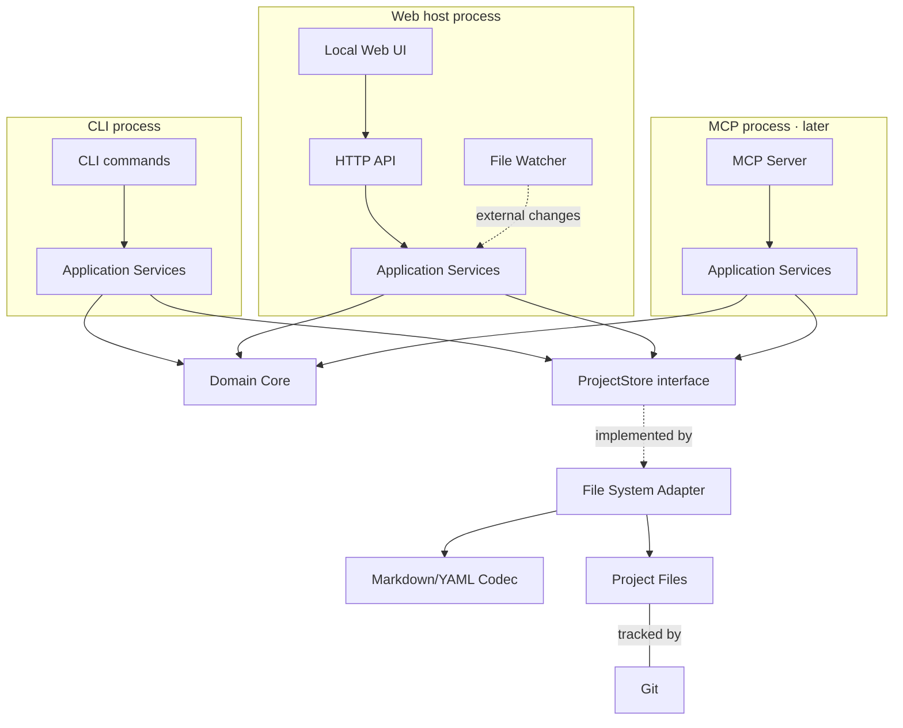
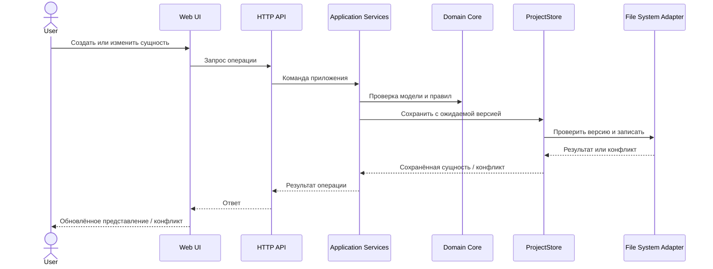
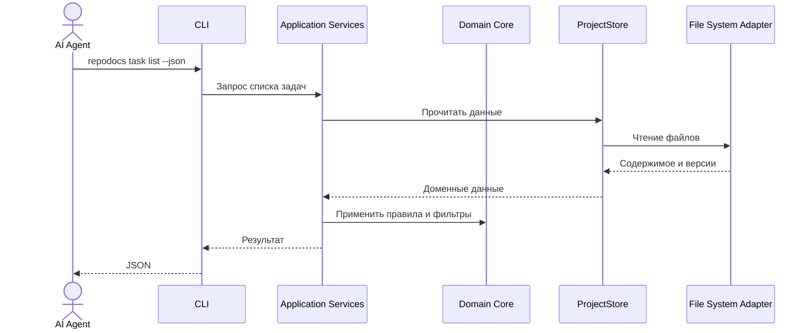

# RepoDocs — Architecture Overview

**Статус:** архитектурный черновик, обновлённый по результатам обсуждения ревью  
**Версия:** 0.2  
**Рабочее название:** RepoDocs  
**Связанные документы:**

- [Product Vision](../product/product-vision.md)
- [Ревью Architecture Overview v0.1](../reviews/architecture-overview-v0.1-review.md)

> Документ фиксирует согласованные архитектурные решения и требования, а также отделяет их от предварительных технических предложений и открытых вопросов. Конкретные контракты модулей, формат хранения и детали реализации будут определяться в последующих спецификациях.

## 1. Цели архитектуры

Архитектура RepoDocs должна обеспечивать:

1. **Локальное хранение.** Данные проекта находятся в файловой системе внутри Git-репозитория.
2. **Git-native workflow.** Изменения проектного контекста представлены изменениями файлов и участвуют в привычных `diff`, `commit`, `branch` и `merge` процессах.
3. **Доступность для людей и агентов.** Данные понятны при ручном чтении и редактировании и доступны через программные интерфейсы.
4. **Независимость от AI-агентов.** Модель данных и интерфейсы RepoDocs не зависят от конкретного агента или поставщика моделей.
5. **Единая прикладная логика.** Web UI, CLI и возможный в будущем MCP используют общие Application Services.
6. **Лёгковесность.** MVP не требует облачной инфраструктуры, собственного AI runtime или серверной системы совместной работы.
7. **Расширяемость без преждевременной сложности.** Архитектура допускает будущие интерфейсы и Workspace, но MVP не реализует их заранее.

## 2. Архитектурные ограничения и принципы

### 2.1. Принятые продуктовые ограничения

- RepoDocs ориентирован прежде всего на индивидуальных разработчиков и небольшие команды.
- Git-репозиторий проекта является основным местом хранения проектной информации.
- RepoDocs управляет информационным контекстом, а не исходным кодом.
- Анализ исходников, AST и построение графа связей с элементами кода не входят в ответственность продукта.
- Связи с реализацией могут выражаться обычными ссылками и идентификаторами в commit messages, Pull Request и других артефактах разработки.
- Собственные AI-функции и AI runtime не входят в MVP и ближайшую перспективу.
- Workspace и мультипроектная агрегация не входят в MVP.

### 2.2. Архитектурные принципы

- **File-based source of truth:** первичные данные проекта хранятся в файлах репозитория.
- **No mandatory external services:** базовая работа не требует облачных сервисов или внешней базы данных.
- **Core before interfaces:** бизнес-правила отделены от Web UI, CLI и MCP.
- **Project boundary:** все операции с данными ограничены корнем явно выбранного проекта RepoDocs.
- **Explicit over implicit:** RepoDocs не сканирует весь диск и не обнаруживает проекты автоматически.
- **Derived data is disposable:** индексы и кэши, если появятся, восстанавливаются из файлов и не являются источником истины.
- **Preserve unknown data:** изменение сущности не должно удалять данные, которые текущая версия RepoDocs не понимает или не изменяет.
- **Safe concurrent writes:** параллельные изменения одной сущности не должны приводить к незаметной потере данных.

## 3. Концептуальная архитектура

Система разделяется на логические компоненты по ответственности. Для MVP это не означает отдельные процессы или npm-пакеты для каждого компонента. CLI и Web-хост запускают общий прикладной код в собственных процессах.



Диаграмма показывает логические границы и основные зависимости. Она не фиксирует окончательную структуру каталогов, контрактов или сборки приложения.

### 3.1. Domain Core

**Назначение:** описывать предметную модель RepoDocs и правила работы с ней.

Предполагаемая ответственность:

- модели задач, документов, решений и связей;
- правила валидации;
- проверка уникальности идентификаторов;
- проверка ссылочной целостности;
- правила допустимых статусов и переходов;
- операции над сущностями и их отношениями.

Domain Core не должен зависеть от React, HTTP, CLI, MCP или конкретного способа хранения.

### 3.2. Application Services

**Назначение:** предоставлять сценарии использования системы поверх Domain Core и интерфейсов доступа к данным.

Примеры операций:

- получить список задач с фильтрами;
- получить задачу или документ по идентификатору;
- создать или обновить задачу;
- создать документ или архитектурное решение;
- добавить связь между сущностями;
- проверить целостность данных проекта.

**Согласованное решение — единый прикладной слой.** Web UI, CLI и возможный в будущем MCP Server используют общие Application Services. Интерфейсы выступают адаптерами к прикладному слою и не должны дублировать бизнес-логику.

Общий прикладной слой не означает, что все интерфейсы должны работать в одном процессе. CLI вызывает Application Services внутри собственного процесса и не зависит от запущенного Web-хоста. Web-хост использует те же реализации Application Services в своём процессе.

### 3.3. ProjectStore

**Назначение:** предоставить Application Services интерфейс чтения и изменения данных одного проекта.

ProjectStore — логический порт (интерфейс) доступа к данным. Application Services не должны зависеть от деталей файловой системы или формата сериализации.

Предполагаемые обязанности контракта:

- чтение сущностей и коллекций;
- создание, изменение и удаление сущностей;
- возврат версии сущности при чтении;
- проверка ожидаемой версии при записи;
- сообщение о конфликте, если данные изменились после чтения.

ProjectStore не содержит предметных бизнес-правил. Его конкретная реализация для MVP описана ниже как File System Adapter.

### 3.4. File System Adapter

**Назначение:** реализовать ProjectStore поверх файловой системы проекта.

Предполагаемая ответственность:

- безопасное чтение и запись файлов в пределах корня проекта;
- атомарная запись;
- взаимодействие с Codec для преобразования представления файла и данных сущности;
- проверка ожидаемой версии перед записью;
- обнаружение и возврат конфликтов конкурентной записи.

File System Adapter не отвечает за отслеживание внешних изменений в режиме реального времени. Это отдельная ответственность Web-хоста.

### 3.5. Markdown/YAML Codec

**Назначение:** преобразовывать файловое представление сущностей RepoDocs в прикладные/доменные данные и обратно.

Если для хранения будет утверждён Markdown с YAML Front Matter, Codec будет отвечать за разбор и формирование этого формата. Сам формат и конкретная библиотека остаются предметом Data Model & Storage Specification.

**Архитектурное требование — сохранение исходного представления (round-trip preservation).** При изменении сущности RepoDocs должен сохранять незатронутые части файла, в том числе:

- порядок и форматирование незатронутых полей Front Matter;
- YAML-комментарии;
- поля, неизвестные текущей версии схемы;
- Markdown-тело, если операция его не изменяла;
- Front Matter, если операция изменяла только Markdown-тело.

Неизвестные текущей версии RepoDocs поля могут игнорироваться при чтении и валидации, но не должны удаляться или изменяться при записи другой части сущности.

Цель требования — совместимость документов между версиями RepoDocs и сохранение содержательных Git diff. Конкретная техника реализации и выбор библиотек определяются при проектировании Codec.

### 3.6. File Watcher

**Назначение:** обнаруживать внешние изменения файлов проекта, чтобы Web UI мог своевременно обновлять представление.

Watcher относится к Web-хосту, а не к ProjectStore. Он не требуется для одноразовых CLI-команд.

Предполагаемое поведение:

- обнаруживать изменения файлов вне RepoDocs;
- уведомлять Web-хост о затронутых сущностях;
- инициировать обновление данных или инвалидирование кэша;
- позволять Web UI обновить представление или показать конфликт, если у пользователя есть несохранённые изменения.

Механизм обнаружения, обработка массовых изменений при Git checkout/merge и детали обновления UI требуют технического проектирования.

### 3.7. Local Web Application

**Назначение:** предоставить человеку графический интерфейс для работы с проектным контекстом.

Предполагаемые части:

- локальный HTTP API / application host;
- Web UI;
- представления задач, документов и решений;
- поиск, фильтрация и навигация по связям;

Web UI не должен самостоятельно читать или изменять файлы проекта. Все операции проходят через Application Services.

**Согласованные решения по Web UI:**

- В MVP Web UI предоставляет просмотр документов с помощью Markdown Preview.
- Редактирование содержимого документов непосредственно в Web UI не входит в MVP.
- Создание собственного Markdown-редактора, включая WYSIWYG, не является целью MVP.
- В дальнейшем можно вернуться к идее *Markdown Friendly* режима: редактирования исходного Markdown-текста с дополнительными удобствами ввода и форматирования (например, горячими клавишами и автопродлением списков). Это возможное направление развития, а не принятое обязательство по реализации.
- Интеграция с внешним редактором/IDE также может рассматриваться отдельно как будущее улучшение; в MVP она не входит.

**Запуск Web UI:**

- `repodocs serve` запускает локальный Web-хост и по умолчанию открывает браузер.
- Флаг `--no-open` отключает автоматическое открытие браузера.
- Используется фиксированный порт. Если он занят, запуск завершается с понятной ошибкой; автоматический выбор другого порта не выполняется.
- Номер порта и поведение при его занятости должны быть явно сообщены пользователю.

### 3.8. CLI

**Назначение:** предоставить интерфейс для терминала, скриптов и AI coding agents.

CLI является самостоятельным интерфейсом MVP и вызывает Application Services внутри собственного процесса. Запущенный Web-хост для выполнения CLI-команд не требуется.

**Согласованная модель запуска:**

- `repodocs` без аргументов показывает краткий статус проекта и справку; Web-сервер не запускается и браузер не открывается.
- `repodocs serve` запускает Web-хост и открывает браузер.
- `repodocs serve --no-open` запускает Web-хост без открытия браузера.
- Команды чтения и изменения данных работают без запущенного Web-хоста.

**Неинтерактивность и вывод:**

- CLI полностью неинтерактивен: команды не задают вопросов и не ожидают пользовательского ввода в процессе выполнения.
- Все необходимые параметры создания и изменения передаются аргументами/флагами.
- Необязательные параметры могут получать значения по умолчанию из конфигурации проекта.
- Явно переданное значение имеет приоритет над настройкой по умолчанию.
- Конкретные значения по умолчанию, включая тип новой задачи, будут определены при проектировании модели данных и конфигурации.
- По умолчанию CLI выводит человекочитаемый текст.
- Флаг `--json` включает машиночитаемый JSON-вывод для команд чтения, создания и изменения.
- JSON-схемы должны быть стабильными и документированными.

Предварительный набор команд:

```bash
repodocs
repodocs init
repodocs serve [--no-open]

repodocs task list [--json]
repodocs task show <id> [--json]
repodocs task create ... [--json]
repodocs task update <id> ... [--json]

repodocs doc list [--json]
repodocs doc show <id> [--json]

repodocs validate
```

Это предварительный набор для планирования MVP, а не окончательная спецификация CLI-контрактов.

### 3.9. MCP Server

**Статус:** возможный следующий этап после базового CLI; не входит в MVP.

MCP Server предоставит агентам операции RepoDocs через Model Context Protocol.

Он должен использовать общие Application Services и не реализовывать собственную бизнес-логику или напрямую обходить Domain Core и ProjectStore.

### 3.10. Git

Git не является отдельной подсистемой RepoDocs и не заменяется им.

RepoDocs хранит данные в рабочем дереве выбранного Git-репозитория. История изменений, ветвление, слияние и публикация изменений остаются ответственностью Git и привычного Git workflow пользователя.

Идентификаторы сущностей должны быть уникальными без координации между Git-ветками и worktree. Создание сущностей в параллельных ветках не должно приводить к коллизиям ID или требовать переименования сущностей и ссылок после merge.

Конкретная схема идентификаторов (например, ULID, UUID или другой вариант) будет определена в Data Model & Storage Specification.

## 4. Основные потоки взаимодействия

### 4.1. Работа человека через Web UI



### 4.2. Работа AI-агента через CLI



CLI работает в собственном процессе и не обращается к HTTP API Web-хоста.

## 5. Определение корня проекта и граница безопасности

MVP работает с одним явно определённым проектом RepoDocs за один запуск команды или Web-хоста.

### 5.1. Определение корня проекта

Согласованная модель:

1. `repodocs init` инициализирует RepoDocs в корне проекта, создавая каталог-маркер `.repodocs/` с конфигурацией.
2. Если передан `--root`, явно указанный корень имеет приоритет над автоматическим поиском.
3. Без `--root` RepoDocs определяет корень текущего Git worktree/репозитория штатными средствами Git, например `git rev-parse --show-toplevel`.
4. Начиная с текущей директории, RepoDocs ищет `.repodocs/` вверх по дереву каталогов, но не выше определённого Git root.
5. Если найдено несколько маркеров, выбирается ближайший к текущей директории.
6. Git root является пределом поиска, а не запасным вариантом корня RepoDocs. Если `.repodocs/` не найден, команда сообщает об ошибке и предлагает выполнить `repodocs init`.
7. Если Git root определить не удалось, команда сообщает понятную ошибку. Поведение вне Git-репозитория не должно неявно подменять собой поиск проекта.

Определение Git root выполняется средствами Git, а не поиском `.git` как каталога. Это необходимо для корректной работы с Git Worktree, где `.git` в рабочей директории является файлом-ссылкой на служебные данные worktree.

### 5.2. Безопасность файловых операций

- Все операции чтения и записи ограничены определённым корнем проекта.
- Пути из пользовательских данных не должны позволять выйти за пределы разрешённого каталога (path traversal).
- Приложение не должно открывать произвольный доступ к файловой системе через HTTP API.
- Ошибки доступа и некорректные данные должны обрабатываться без повреждения существующих файлов.

### 5.3. Безопасность локального HTTP-сервера

**Требование MVP:** Web-хост слушает только loopback-интерфейс. Доступ с других устройств по локальной сети не входит в MVP.

Дополнительно архитектура должна предусматривать:

- проверку заголовка `Host`;
- проверку `Origin` для браузерных запросов, особенно изменяющих состояние;
- авторизацию локального Web-клиента с использованием токена или эквивалентного механизма;
- защиту изменяющих запросов от CSRF;
- безопасное создание, передачу, хранение и исключение утечки токенов в URL, логах и других каналах.

Loopback сам по себе не считается достаточной защитой от запросов, инициированных сторонними веб-страницами, включая сценарии DNS rebinding.

**После MVP:** доступ к Web UI с других устройств в локальной сети (например, с телефона) может быть добавлен как отдельная возможность. Для него потребуется явно включаемый сетевой режим и полноценная авторизация клиентов. Локальная сеть не должна автоматически считаться доверенной.

Конкретная схема токенов, проверок запросов и авторизации определяется при техническом проектировании Web-хоста и API.

## 6. Согласованность данных и внешние изменения

Данные RepoDocs хранятся в обычных файлах. Их могут изменять RepoDocs, пользователь, Git operations, внешний редактор или AI-агент. Архитектура должна учитывать параллельные и внешние изменения.

### 6.1. Атомарная запись и конкурентный доступ

- Запись должна быть защищена от появления частично записанных файлов (например, с использованием временного файла и атомарной замены, где это поддерживается).
- При чтении ProjectStore возвращает сущность и токен её версии.
- При записи вызывающая сторона передаёт ожидаемую версию.
- Если файл изменился после чтения, запись отклоняется с конфликтом версии.
- Проверка версии и запись должны образовывать одну атомарную с точки зрения конкурентных изменений операцию. Между проверкой и записью не должно оставаться окна для Race Condition.
- Конкретный механизм синхронизации, блокировок и атомарности определяется при техническом проектировании ProjectStore.

Токен версии может быть основан на хэше содержимого файла, но конкретный формат токена пока не утверждён.

### 6.2. Обработка конфликтов

- ProjectStore обнаруживает конфликт и не выполняет незаметную перезапись.
- Application Services возвращает вызывающему интерфейсу понятный результат конфликта.
- Web UI должен показать пользователю, что сущность изменилась, и предоставить безопасный путь к разрешению конфликта.
- CLI сообщает о конфликте и возвращает ненулевой код завершения, чтобы агент мог перечитать актуальные данные и принять решение о повторной операции.
- Точные варианты разрешения конфликта в Web UI и правила повторной записи требуют отдельного проектирования.

### 6.3. Внешние изменения и File Watcher

Watcher работает на стороне Web-хоста. Он обнаруживает внешние изменения и помогает обновлять UI, но не заменяет проверку версии при записи.

Если в открытой форме нет несохранённых правок, UI может обновить данные автоматически. Если локальные правки есть, перед сохранением требуется проверка версии; конфликт нельзя разрешать молчаливой перезаписью.

### 6.4. Сохранение исходного представления

Требования к сохранению комментариев, неизвестных полей, порядка и форматирования Front Matter, а также незатронутого Markdown-тела определены в разделе 3.5. Они являются частью архитектурного контракта Codec и должны проверяться тестами.

## 7. Предлагаемая структура программных модулей

Один из возможных вариантов логической организации кода:

```text
src/
├── core/
│   ├── domain/
│   └── validation/
├── application/
│   ├── tasks/
│   ├── documents/
│   └── projects/
├── adapters/
│   ├── project-store-fs/
│   ├── markdown-yaml-codec/
│   ├── cli/
│   └── http/
├── web/
│   ├── components/
│   ├── pages/
│   └── features/
└── host/
    ├── file-watcher/
    └── server/
```

Это иллюстративная структура логических модулей, а не утверждённая структура каталогов или пакетов. В MVP компоненты могут находиться в одном приложении и одном npm-пакете. Разделение на отдельные процессы или пакеты для ProjectStore, Codec и Watcher не требуется.

Окончательная структура зависит от выбранного стека и контрактов модулей.

## 8. Технологический стек

Ранее обсуждался следующий кандидат для MVP:

| Область | Предварительный кандидат |
| --- | --- |
| Язык | TypeScript |
| Runtime | Node.js |
| Web UI | React |
| Сборка UI | Vite |
| Формат данных | Markdown + YAML Front Matter |
| Валидация | Zod |

Этот набор пока **не утверждён**. При выборе необходимо учитывать простоту локального запуска, удобство разработки, размер и сложность поставки, качество файловых API и возможность повторного использования кода между CLI и Web UI.

SQLite не рассматривается как первичное хранилище. В будущем он может быть добавлен как восстанавливаемый локальный индекс, если реальные требования к поиску или агрегации этого потребуют.

## 9. Workspace и мультипроектность в будущем

Workspace не входит в MVP. Проекты RepoDocs должны оставаться автономными независимо от будущего появления Workspace.

Согласованные архитектурные принципы для будущего расширения:

- каждый Git-репозиторий остаётся автономным;
- данные RepoDocs хранятся внутри соответствующего проекта;
- проект не знает о существовании Workspace и не зависит от него;
- Workspace является отдельным пользовательским слоем, который знает о подключённых проектах;
- Workspace агрегирует данные через Application Services соответствующих проектов и не обращается напрямую к их файловым хранилищам в обход прикладного слоя;
- взаимодействие проектов с Workspace, включая возможные уведомления, не проектируется до отдельного этапа проектирования Workspace;
- список проектов задаётся явно; автоматическое сканирование всего диска не является поведением по умолчанию.

Для будущей реализации рассматривается понятие **Project Context** — набор Application Services и хранилища, привязанный к одному корню проекта. Workspace сможет работать с несколькими такими контекстами. В MVP используется один контекст проекта; отдельная подсистема Workspace не создаётся.

Возможное расположение пользовательской конфигурации:

```text
~/.repodocs/
└── workspace.yaml
```

Формат конфигурации и расположение остаются предварительными.

## 10. Границы MVP

### 10.1. В MVP входят

- работа с одним явно определённым Git-проектом RepoDocs за один запуск;
- Domain Core и единый Application Services;
- CLI как самостоятельный интерфейс, работающий без Web-хоста;
- локальное Web Application;
- ProjectStore и файловая реализация;
- Codec с сохранением неизвестных полей и незатронутого форматирования;
- File Watcher на стороне Web-хоста;
- неинтерактивный CLI с человекочитаемым выводом по умолчанию и `--json`;
- определение корня через Git и маркер `.repodocs/`;
- контроль конкурентной записи и обнаружение конфликтов версий;
- безопасная работа с файлами в пределах корня проекта;
- Web-хост только на loopback с защитой браузерных запросов;
- Markdown Preview.

### 10.2. Не входят в MVP

- Workspace и мультипроектная агрегация;
- MCP Server (возможный следующий этап после CLI);
- собственный AI runtime и интеграция с моделями;
- серверная командная работа и управление ролями;
- доступ к Web UI с других устройств по LAN;
- редактирование содержимого документов в Web UI;
- Markdown Friendly режим редактирования (возможное направление развития после MVP);
- интеграция с внешним редактором/IDE;
- WYSIWYG-редактор;
- GitHub/GitLab Issues и двусторонняя синхронизация;
- анализ исходного кода;
- автоматическое сканирование диска и обнаружение проектов;
- обязательная внешняя база данных или облачный сервис.

## 11. Открытые вопросы и следующие спецификации

Ревью и последующее обсуждение закрыли первоначальные вопросы о едином Application Services, модели запуска, базовом поведении CLI, Markdown Preview и границах Web-доступа. Следующие вопросы остаются открытыми и не должны считаться утверждёнными только на основании этого документа.

### 11.1. Data Model & Storage Specification

Предстоит определить:

1. Окончательный формат хранения сущностей и структуру файлов.
2. Подтверждается ли Markdown + YAML Front Matter для всех типов сущностей.
3. Подтверждается ли принцип «один файл на сущность».
4. Модель типов задач, статусов, приоритетов и настраиваемых значений по умолчанию.
5. Конкретный формат уникальных идентификаторов (ULID, UUID или другой).
6. Контракты ProjectStore и Codec.
7. Формат токена версии и механизм атомарной проверки/записи.
8. Правила валидации и обратной совместимости схемы.

### 11.2. CLI Specification

Предстоит определить:

- полный перечень команд и обязательных параметров;
- точные схемы JSON-ответов и ошибок;
- коды завершения;
- правила конфигурации значений по умолчанию;
- точный номер фиксированного порта Web-хоста.

### 11.3. Web UI и Web Host Specification

Предстоит определить:

- конкретную схему локальной авторизации и CSRF-защиты;
- жизненный цикл токена и безопасный способ его передачи браузеру;
- точный сценарий отображения и разрешения конфликтов;
- поведение File Watcher при Git checkout/merge и массовых изменениях;

## 12. Согласованные решения и требования

| ID | Решение или требование | Статус |
| --- | --- | --- |
| D-01 | Web UI, CLI и будущий MCP используют единый Application Services | Согласовано |
| D-02 | CLI-first модель запуска; `repodocs` показывает статус/справку, `repodocs serve` запускает Web UI | Согласовано |
| D-03 | CLI полностью неинтерактивен | Согласовано |
| D-04 | Человекочитаемый вывод по умолчанию; `--json` для команд чтения и изменения | Согласовано |
| D-05 | В MVP Web UI предоставляет Markdown Preview; редактирование содержимого документов в UI не входит в MVP | Согласовано |
| D-06 | Markdown Friendly режим редактирования и интеграция с внешним редактором/IDE могут рассматриваться как будущие улучшения, но не входят в MVP | Согласовано |
| D-07 | Web-хост использует фиксированный порт и завершается с ошибкой, если порт занят | Согласовано |
| A-01 | Логически разделить ProjectStore, File System Adapter, Codec и File Watcher без отдельных пакетов/процессов для этих компонентов | Согласовано |
| A-02 | Проекты автономны; будущий Workspace обращается к ним через Application Services | Согласовано |
| A-03 | Optimistic concurrency; проверка версии и запись защищены от Race Condition | Согласовано как требование |
| A-04 | Сохранять неизвестные поля, комментарии, форматирование и незатронутые части файла | Согласовано как требование |
| A-05 | Уникальные ID без координации между ветками и worktree | Согласовано как требование |
| A-06 | CLI вызывает Application Services внутри собственного процесса | Согласовано |
| A-07 | MVP Web-хост ограничен loopback и защищён от поддельных браузерных запросов | Согласовано как требование |
| A-08 | Корень проекта определяется через Git root и маркер `.repodocs/` | Согласовано |

## 13. Связанные документы

- [Product Vision](../product/product-vision.md) — назначение, аудитория, принципы и границы продукта.
- [Architecture Overview Review v0.1](../reviews/architecture-overview-v0.1-review.md) — исходное архитектурное ревью Claude Code.
- [Data Model & Storage Specification](data-model.md) — будущая спецификация сущностей и файлового хранения.
- [CLI Specification](cli-specification.md) — будущая спецификация команд и форматов вывода.
- [Web UI & Host Specification](web-host-specification.md) — будущая спецификация локального Web-хоста и UI.
- [MVP Scope & Roadmap](../planning/roadmap.md) — будущая детализация этапов и состава MVP.

---

*Architecture Overview фиксирует согласованные архитектурные границы и требования. Технологический стек, контракты модулей, структура хранения и конкретные механизмы реализации требуют отдельных спецификаций и согласования.*
